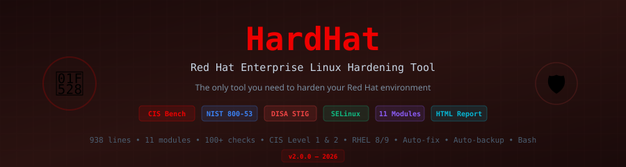

<div align="center">



<br>

[]()
[](LICENSE)
[]()
[]()
[]()
[]()
[]()
[]()

**The only tool you need to harden your Red Hat environment.**

[Quick Start](#-quick-start) · [Modules](#-modules) · [Usage](#-usage) · [Standards](#-standards) · [Contributing](#-contributing)

</div>

---

## What is HardHat?

HardHat is a **comprehensive, open-source Bash tool** for hardening Red Hat Enterprise Linux (RHEL), CentOS, Rocky Linux, and AlmaLinux. It performs **100+ security checks** across 11 modules, aligned to CIS Benchmark, NIST 800-53, and DISA STIG standards.

```
One script. 11 modules. 100+ checks. Your Red Hat — secured.
```

### Why HardHat?

- **Single script** — no dependencies, no agents, no frameworks. Just Bash.
- **Audit + Fix** — find gaps AND remediate them automatically
- **Auto-backup** — every config change is backed up before modification
- **HTML reports** — professional reports for compliance evidence
- **Modular** — run all checks or target specific modules
- **CIS/NIST/STIG** — mapped to industry standards with control IDs
- **RHEL 8 & 9** — tested on RHEL, CentOS Stream, Rocky, Alma

---

## 🚀 Quick Start

```bash
# Clone
git clone https://github.com/SiteQ8/HardHat.git
cd HardHat

# Audit only (no changes)
sudo ./hardhat.sh --audit

# Audit + auto-fix
sudo ./hardhat.sh --fix

# Dry run (show what would change)
sudo ./hardhat.sh --dry-run

# Specific modules only
sudo ./hardhat.sh --module ssh,network,selinux

# CIS Level 2 profile
sudo ./hardhat.sh --fix --profile level2
```

### One-Liner Install & Run

```bash
curl -sL https://raw.githubusercontent.com/SiteQ8/HardHat/main/hardhat.sh | sudo bash -s -- --audit
```

---

## 📦 Modules

HardHat includes **11 hardening modules** covering every critical area:

| # | Module | CIS Section | Checks | What It Does |
|---|--------|-------------|--------|-------------|
| 1 | **Filesystem** | CIS 1.1 | 15+ | Disable unused FS (cramfs, squashfs, udf), /tmp partitioning, mount options (nodev, nosuid, noexec), sticky bit enforcement |
| 2 | **Packages** | CIS 1.2-1.3 | 4 | GPG keys, gpgcheck enforcement, pending updates audit, AIDE file integrity installation |
| 3 | **Boot** | CIS 1.4-1.5 | 4 | GRUB2 bootloader password, config permissions, core dump restriction, ASLR enforcement |
| 4 | **SELinux** | CIS 1.6 | 5 | SELinux installed, not disabled in bootloader, targeted policy, Enforcing mode, unconfined services audit |
| 5 | **Network** | CIS 3.1-3.5 | 25+ | 20 kernel sysctl parameters (IP forwarding, redirects, source routing, SYN cookies, martians, ICMP), firewall status, wireless, uncommon protocols |
| 6 | **SSH** | CIS 5.2 | 20+ | 17 sshd_config parameters (root login, empty passwords, ciphers, MACs, timeouts, X11, TCP forwarding), key permissions, strong algorithms |
| 7 | **Accounts** | CIS 5.3-5.6 | 10+ | Password policy (max/min days, warn age), system accounts lockdown, root GID, umask, su restriction, UID 0 audit, empty password detection |
| 8 | **Logging** | CIS 4.1-4.2 | 8+ | auditd installation/enablement, 10 audit rules (time, hostname, identity, sudo, logins, SELinux, audit logs), rsyslog, log permissions |
| 9 | **Services** | CIS 2.1-2.2 | 22+ | Disable 21 unnecessary services (avahi, cups, dhcpd, telnet, rsh, NFS, SNMP, etc.), NTP validation |
| 10 | **Permissions** | CIS 6.1-6.2 | 12+ | Critical file permissions (/etc/passwd, shadow, group, gshadow), world-writable files, unowned files, SUID/SGID audit |
| 11 | **Banners** | CIS 1.7 | 4+ | Login warning banners (/etc/motd, /etc/issue, /etc/issue.net), OS information leakage detection |

---

## 📋 Usage

```
Usage: hardhat.sh [OPTIONS]

Options:
  --audit          Audit only (no changes, just report)
  --fix            Audit + apply fixes (default)
  --dry-run        Show what would be changed
  --profile LEVEL  CIS profile: level1, level2, stig (default: level1)
  --module MOD     Run specific module(s), comma-separated
  --report         Generate HTML report
  --version        Show version
  --help           Show this help

Available Modules:
  filesystem, packages, boot, selinux, network, ssh,
  accounts, logging, services, permissions, banners
```

### Examples

```bash
# Full audit with HTML report
sudo ./hardhat.sh --audit

# Fix only SSH and network
sudo ./hardhat.sh --fix --module ssh,network

# CIS Level 2 hardening
sudo ./hardhat.sh --fix --profile level2

# Dry run everything
sudo ./hardhat.sh --dry-run
```

### Output

```
  [PASS] CIS 1.6.1.4 — SELinux mode: Enforcing
  [FAIL] CIS 5.2.x — SSH PermitRootLogin = 'yes' (expected: no)
  [WARN] CIS 1.2.3 — 12 package updates available
  [INFO] Set strong SSH ciphers

═══════════════════════════════════════════════════
  HardHat Hardening Summary
═══════════════════════════════════════════════════
  PASS:  78
  FAIL:  15
  WARN:  8
  SKIP:  2
  TOTAL: 103

  Score: 76% — Needs improvement

  Log:    /var/log/hardhat/hardhat-20260309-143022.log
  Report: /var/log/hardhat/hardhat-report-20260309-143022.html
  Backup: /var/backups/hardhat/20260309-143022
═══════════════════════════════════════════════════
```

---

## 📊 Reports

HardHat generates **HTML reports** automatically with every run:

- Color-coded results (PASS/FAIL/WARN)
- System information (hostname, RHEL version, profile)
- Full audit log
- Compliance score percentage
- Timestamp and backup path

Reports are saved to `/var/log/hardhat/` for compliance evidence.

---

## 📐 Standards Alignment

| Standard | Coverage | Description |
|----------|----------|-------------|
| **CIS Benchmark RHEL 8/9** | Level 1 + Level 2 | Center for Internet Security — industry gold standard |
| **NIST SP 800-53** | AC, AU, CM, IA, SC | Access Control, Audit, Config, Auth, System Protection |
| **DISA STIG** | CAT I, II, III | Defense Information Systems Agency technical guidance |
| **NIST SP 800-171** | Partial | Protecting CUI in non-federal systems |
| **PCI DSS v4.0** | Partial | Payment card data protection requirements |

---

## 🔒 What Gets Hardened

### Kernel & Filesystem
- Disable cramfs, freevxfs, jffs2, hfs, hfsplus, squashfs, udf, usb-storage
- /tmp, /var, /var/log, /home partition verification
- nodev, nosuid, noexec mount options
- Sticky bit enforcement on world-writable directories
- ASLR (Address Space Layout Randomization)
- Core dump restriction

### Network
- 20 sysctl hardening parameters
- IP forwarding disabled
- ICMP redirect prevention
- SYN cookie protection
- Martian packet logging
- Reverse path filtering
- Firewall enforcement (firewalld/nftables/iptables)
- Uncommon protocol blocking (DCCP, SCTP, RDS, TIPC)

### SSH
- Root login disabled
- Empty password authentication blocked
- Strong ciphers (AES-GCM, AES-CTR only)
- Strong MACs (SHA2-512, SHA2-256 only)
- Idle timeout (300s / 3 retries)
- X11 forwarding disabled
- TCP forwarding disabled
- Login grace period (60s)
- Banner enforcement

### Access Control
- SELinux enforcing mode
- Password policy (365 max, 1 min, 7 warn)
- System account lockdown (nologin shell)
- UID 0 restriction (root only)
- Empty password detection
- su restriction via pam_wheel
- Default umask verification

### Audit & Monitoring
- auditd installation and activation
- 10 audit rules (time, hostname, identity, sudo, logins, MAC, audit logs)
- rsyslog validation
- Log file permission audit

### Services
- 21 unnecessary services disabled and masked
- NTP/chrony time synchronization verification

---

## 🏗️ Architecture

```
hardhat.sh
├── Banner & CLI parsing
├── Root check & RHEL detection
├── Auto-backup system
├── Module 1:  Filesystem       (CIS 1.1)
├── Module 2:  Packages         (CIS 1.2-1.3)
├── Module 3:  Boot             (CIS 1.4-1.5)
├── Module 4:  SELinux           (CIS 1.6)
├── Module 5:  Network          (CIS 3.1-3.5)
├── Module 6:  SSH              (CIS 5.2)
├── Module 7:  Accounts         (CIS 5.3-5.6)
├── Module 8:  Logging          (CIS 4.1-4.2)
├── Module 9:  Services         (CIS 2.1-2.2)
├── Module 10: Permissions      (CIS 6.1-6.2)
├── Module 11: Banners          (CIS 1.7)
├── HTML Report Generation
└── Summary & Scoring
```

---

## 🤝 Contributing

Contributions welcome:

- 📋 **More CIS checks** — expand Level 2 and STIG coverage
- 🐛 **Bug fixes** — test on different RHEL/CentOS versions
- 📖 **Documentation** — improve module descriptions
- 🧪 **Testing** — automated testing framework
- 🌐 **Translations** — Arabic, Spanish, Chinese
- 📦 **Packaging** — RPM/DEB packaging

See [CONTRIBUTING.md](CONTRIBUTING.md).

---

## ⚠️ Disclaimer

HardHat modifies system configuration files when run with `--fix`. **Always**:

1. **Test in a non-production environment first**
2. **Review the audit report** before applying fixes
3. **Verify backups** in `/var/backups/hardhat/`
4. **Use `--dry-run`** to preview changes
5. **Keep a rollback plan** for production systems

This tool is provided as-is. The author is not responsible for any system issues caused by hardening changes.

---

## 📄 License

MIT License — see [LICENSE](LICENSE).

---

<div align="center">
  <sub>🔨 HardHat — Your destination for a secured Red Hat environment</sub><br>
  <sub>Built by <a href="https://github.com/SiteQ8">@SiteQ8</a> — Ali AlEnezi 🇰🇼</sub><br>
  <sub>CIS Benchmark · NIST 800-53 · DISA STIG · SELinux · 938 lines of pure Bash</sub>
</div>
